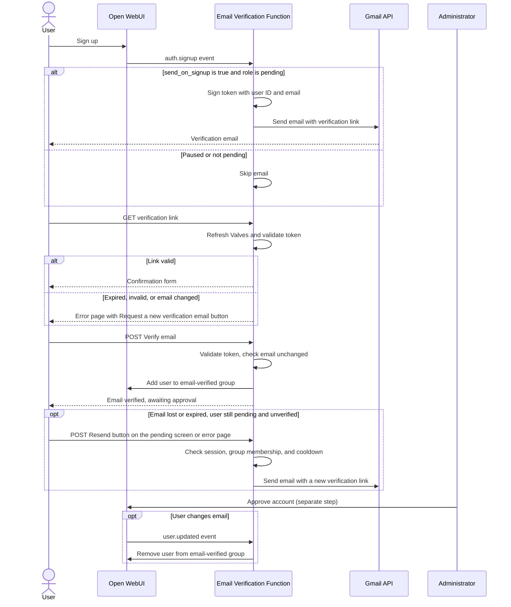

# Open WebUI Functionality

This part of the repository contains definitions of additional functionality created in the Open WebUI instance. Implementations may contain:

- Open WebUI Functions such as Filters, Actions, and Events, with configurable Valves
- Open WebUI Tools
- etc

## Components

### Functions

- Request Quota Guard from [oi_request_quota_guard.py](functions/oi_request_quota_guard.py). Restricts the number of user requests per minute and also logs user request usage.
- Rate Limit Enforcer from [oi_rate_limit_enforcer.py](functions/oi_rate_limit_enforcer.py). Restricts the number of user requests per minute.
- SciLifeLab Email Verification from [oi_email_verification_callback.py](functions/oi_email_verification_callback.py). An Event Function that sends signup verification emails through the Gmail API and records email ownership in the `email-verified` group. See [Email verification](#email-verification) for setup.
- SciLifeLab Account Approval Notification from [oi_account_approval_notification.py](functions/oi_account_approval_notification.py). An Event Function that emails users through the Gmail API when an administrator changes their role from `pending` to `user`. See [Account approval notification](#account-approval-notification) for setup.

Activate either the Request Quota Guard or the Rate Limit Enforcer filter, not both.

### Actions

- Rate Limit Feedback from [oi_rate_limit_ui_button.py](functions/oi_rate_limit_ui_button.py). Adds a UI button that displays the current configured user request limit.

### Valves

- [oi_valves.py](functions/oi_valves.py) contains configurable settings.
- Individual Functions also define their own admin Valves, including the five [email verification valves](#email-verification-valves) and the four [account approval valves](#account-approval-valves).

## Installation

Only admin users can install and manage the Functions in Open WebUI.

To install:

1. Open the Admin Panel in Open WebUI as an admin user.
2. Navigate to the Functions tab and click on New Function.
3. Paste in the definition of the function in the window.
4. The Title, Description, and function id will be filled in automatically for you.
5. Click on Save.
6. Click the back arrow to return to the overview of Functions and enable the Function. Set filters and actions to Global if they should apply across models. Event Functions, such as email verification and account approval notification, only need to be enabled; they respond to application events.

To modify a setting (valve) for a function, click on the configuration icon and edit the value.

## Email verification

Use an Open WebUI build that supports Event Functions and the `auth.signup` and `user.updated` events. The callback sends verification emails for newly created accounts with the `pending` role. Opening the email link displays a confirmation form; clicking **Verify email** submits a POST that adds the user to the `email-verified` group. Visiting the link alone does not verify the account.

Verification does not change the user's role or approve the account. Administrator approval remains separate. When a user's email address changes, the Function removes their verification group membership, and links issued for the previous address are rejected. It does not automatically send a replacement email on email changes; users can [request one](#resending-verification-emails).



The confirmation, success, and error pages use Open WebUI-style layouts with browser-preference light/dark colors and a link back to Open WebUI. They load no external resources.

When a link is expired, invalid, missing its token, or was issued for a previous email address, both the link and the **Verify email** submission return an HTTP 400 error page with a **Request a new verification email** button. The button opens the [resend page](#resending-verification-emails), which applies the usual session and eligibility checks. Other failures, such as a deleted account or a missing `email-verified` group, show an error page without the button.

### Setup

1. In Open WebUI, create a group named exactly `email-verified`, with no granted permissions and sharing disabled. The group name is fixed in the Function.
2. Set the default signup role to `pending`.
3. Configure a Google service account with delegation to the sending Workspace mailbox and the Gmail scope `https://www.googleapis.com/auth/gmail.send`. The From address must be authorized for that mailbox.
4. Configure the environment variables below for every Open WebUI replica. Supply credentials and signing secrets through Kubernetes Secrets.
5. Install and enable `oi_email_verification_callback.py` using the installation steps above, then configure its Valves. Open WebUI installs the packages from the Function's `requirements` header (`google-auth`, `requests`, `itsdangerous`) when loading it; if runtime package installation is unavailable, include them in the image.
6. Optionally add the [resend button](#resending-verification-emails) to the pending-user screen.
7. Restart all Open WebUI replicas after initial installation or changes to deployment settings so each process registers the configured GET/POST callback and resend routes before the frontend catch-all route.

### Deployment settings

| Environment variable | Value / purpose |
| --- | --- |
| `EMAIL_VERIFICATION_URL` | Full public HTTPS callback URL, e.g. `https://your-host/auth/verify-email`. Must have a non-root path and no query string or fragment. |
| `GMAIL_CREDENTIALS_JSON` | Google service-account credentials as JSON, supplied from a Kubernetes Secret. |
| `GMAIL_DELEGATED_USER` | Existing Google Workspace mailbox the service account impersonates. |
| `GMAIL_SENDER_EMAIL` | Authorized From / Send As address for that mailbox. |
| `WEBUI_SECRET_KEY` | Shared Open WebUI signing secret, identical across replicas. |
| `EMAIL_VERIFICATION_SECRET` | Optional dedicated verification signing secret, identical across replicas. If omitted, the Function uses `WEBUI_SECRET_KEY`. |

The Function stays inactive until `EMAIL_VERIFICATION_URL` and all `GMAIL_*` variables are set: it registers no routes, sends no email, and logs a warning naming the missing variables. This keeps environments without Gmail settings, such as one restored from another deployment's database, from sending email. These settings are not Valves. Keep the callback URL stable while links are outstanding, and use the same signing configuration on every replica.

### Email verification valves

Saved admin Valve values override the optional environment defaults below. When neither is set, the built-in default applies. Environment defaults are read when the Function is loaded; changing them does not replace a saved Valve value.

| Valve | Built-in default | Environment default | Purpose |
| --- | --- | --- | --- |
| `token_ttl` | `24h` | `EMAIL_VERIFICATION_TOKEN_TTL` | Link lifetime: a positive integer number of seconds, or a duration with `s`, `m`, `h`, or `d`, e.g. `3600`, `30m`, `24h`, `7d`. |
| `sender_name` | `SciLifeLab OpenLLM` | `EMAIL_VERIFICATION_SENDER_NAME` | Display name in the From header; does not change the sending mailbox. |
| `email_subject` | `SciLifeLab OpenLLM: Verify your email address` | `EMAIL_VERIFICATION_SUBJECT` | Verification email subject. |
| `send_on_signup` | `true` | `EMAIL_VERIFICATION_SEND_ON_SIGNUP` | Whether to send verification emails for new pending signups and resend requests. |
| `resend_cooldown` | `5m` | `EMAIL_VERIFICATION_RESEND_COOLDOWN` | Minimum time between emails to the same user, in the same duration format as `token_ttl`. Counted from the signup email or the last resend. |

Sender name and subject must be nonempty and contain no control characters. Invalid `token_ttl` and `resend_cooldown` durations are rejected. `send_on_signup` accepts boolean values such as `true`/`false`. Environment defaults are validated the same way; an invalid value prevents the Function from loading.

Changing `token_ttl` also changes the validity window for already-issued links. All callback and resend routes refresh saved Valves before validating tokens, so subsequent verification requests use the current TTL across replicas.

To pause new signup and resent emails, set `send_on_signup=false` while keeping the Function enabled. Existing links and email-change revocation continue working. Re-enabling sending does not send emails retroactively to signups that occurred during the pause.

Disabling the Function in the admin interface stops event handling, including email-change revocation; it does not remove routes already registered in a running process until it restarts. Use `send_on_signup` for an email-only pause.

### Resending verification emails

Pending users who have not verified their email can request a new link from the Open WebUI account pending screen. The Function registers `EMAIL_VERIFICATION_URL` + `/resend` (e.g. `/auth/verify-email/resend`): GET shows a confirmation button and POST sends the email.

To show the button, set Admin Settings > General > **Pending User Overlay Content** (or the `PENDING_USER_OVERLAY_CONTENT` environment variable) to text that includes a form posting to the resend path. Keep the form on a single line, because the overlay converts line breaks to `<br>`:

```html
Please verify your email address using the link we sent you. Your account will then be reviewed by an administrator.
<form method="post" action="/auth/verify-email/resend"><button type="submit" style="margin-top:1rem;padding:.5rem 1.25rem;border-radius:9999px;background:rgba(128,128,128,.15);cursor:pointer">Resend verification email</button></form>
```

A markdown link such as `[Resend verification email](/auth/verify-email/resend)` also works and opens the GET confirmation page.

A resend request sends a new link only when all of these are true:

- The request carries a valid Open WebUI session (the `token` cookie issued at signup). Signed-out visitors get a sign-in prompt. When MFA is enabled, Open WebUI issues no session to pending users, so the button cannot identify them.
- The user's role is `pending`, they are not in `email-verified`, and the group exists.
- `send_on_signup` is `true`.
- No email was sent to that user within `resend_cooldown`. The cooldown is held in memory per backend process, so with several replicas or workers a user can receive up to one email per process per cooldown, and a restart clears it.

Cross-site POSTs are rejected using the `Origin` and `Sec-Fetch-Site` headers, in addition to the default `SameSite=Lax` auth cookie. Earlier links remain valid until `token_ttl` expires. Gmail failures show an error page and do not start the cooldown.

## Account approval notification

[oi_account_approval_notification.py](functions/oi_account_approval_notification.py) sends an email when a user's role changes from `pending` to `user`, for example when an administrator approves the account in Admin Panel > Users or a SCIM provider activates it. It is independent of email verification and does not check the `email-verified` group.

Open WebUI's `user.role_updated` event (and SCIM's `user.updated` event) contains only the new role. To recognize approvals, the Function stores the key `scilifelab_awaiting_approval` in the user's `info` field while the user is `pending`:

- when the account is created (`user.created` / `auth.signup`) with the `pending` role;
- when a user's role changes to `pending`;
- for all existing `pending` users, the first time each backend process handles any event after loading the Function.

When a marked user's role becomes `user`, the Function removes the marker and sends the email. Role changes for unmarked users, such as demoting an admin to `user`, send nothing. A change from `pending` to `admin` or another role removes the marker without an email. The marker is removed before sending, so repeated events do not send twice; Gmail failures are logged and not retried.

Limitations:

- An account approved before any event reaches the Function after installation may not have been marked yet, so no email is sent for it. Installing the Function, then any action that publishes an event, such as a new signup or an administrator editing a user, marks existing pending users.
- Role changes Open WebUI makes without publishing an event, such as OAuth role management at sign-in, do not trigger emails.

### Account approval setup

1. Configure the Gmail deployment settings `GMAIL_CREDENTIALS_JSON`, `GMAIL_DELEGATED_USER`, and `GMAIL_SENDER_EMAIL` as described under [email verification deployment settings](#deployment-settings). The Helm chart sets them when `emailVerification.enabled=true`. The Function stays inactive, logging one warning, until all three are set.
2. Install and enable `oi_account_approval_notification.py` using the [installation steps](#installation). Open WebUI installs the `google-auth` and `requests` packages from its `requirements` header.
3. Optionally set the `login_url` Valve, or set Open WebUI's `WEBUI_URL`, so the email contains a sign-in link.

No restart is needed; the Function registers no routes.

### Account approval valves

Saved admin Valve values override the optional environment defaults below. Environment defaults are read and validated when the Function is loaded.

| Valve | Built-in default | Environment default | Purpose |
| --- | --- | --- | --- |
| `send_on_approval` | `true` | `ACCOUNT_APPROVAL_SEND` | Whether to send approval emails. When `false`, approvals clear the marker without an email; emails are not sent retroactively. |
| `sender_name` | `SciLifeLab OpenLLM` | `ACCOUNT_APPROVAL_SENDER_NAME` | Display name in the From header and the email text. |
| `email_subject` | `SciLifeLab OpenLLM: Your account has been approved` | `ACCOUNT_APPROVAL_SUBJECT` | Approval email subject. |
| `login_url` | empty | `ACCOUNT_APPROVAL_LOGIN_URL` | HTTPS sign-in link included in the email. When empty, Open WebUI's `WEBUI_URL` is used if it is an HTTPS URL; otherwise the email has no link. |

Sender name and subject must be nonempty and contain no control characters; `login_url` must be empty or an HTTPS URL.

## Tests

Run the unit tests with the optional test dependencies from [pyproject.toml](pyproject.toml):

```bash
cd openwebui-functionality
uv run --extra test pytest
```

Email verification tests cover environment defaults and saved overrides, duration and email header validation, signup sending and pausing, inactivity when deployment settings are missing, email-change revocation, TTL refresh on existing routes, error pages for expired, invalid, and outdated links, resend eligibility, cooldown, and cross-site rejection, and email branding. Account approval notification tests cover Valve defaults and validation, pending-user marking and backfill, approval emails from role and SCIM events, no email for unmarked users, admin approvals, or paused sending, idempotency, inactivity when deployment settings are missing, sign-in link selection, and email content. Gmail and Open WebUI database calls are mocked; no real emails are sent.
