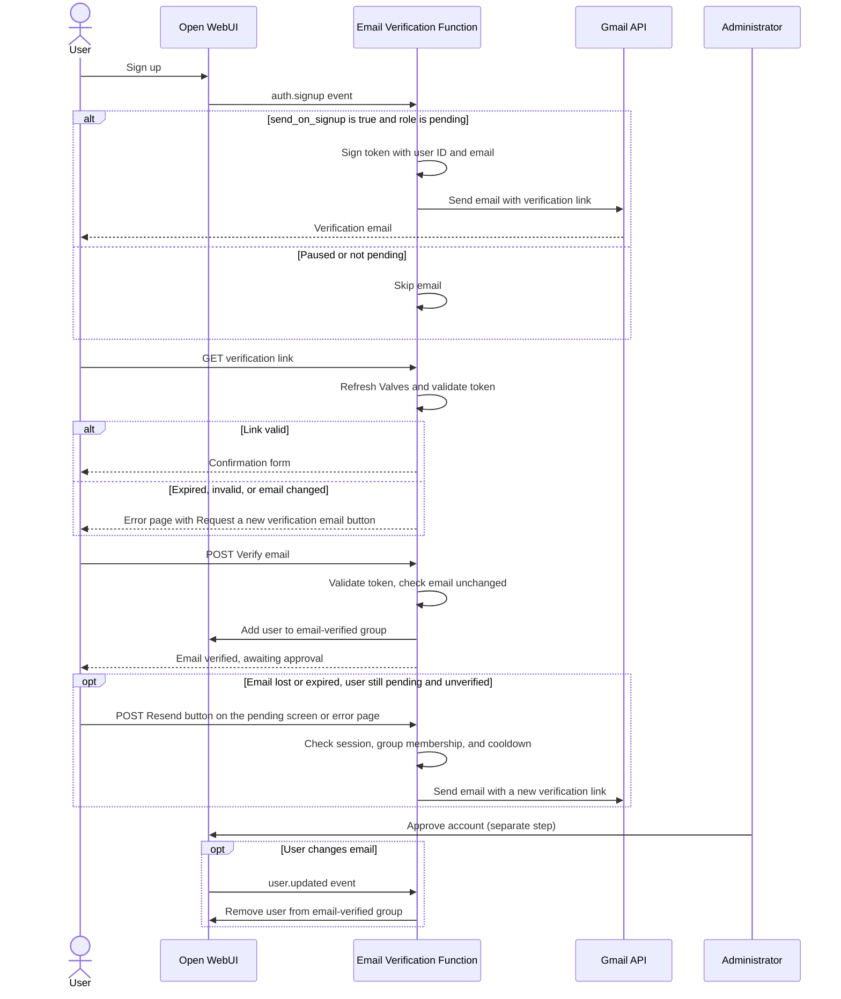
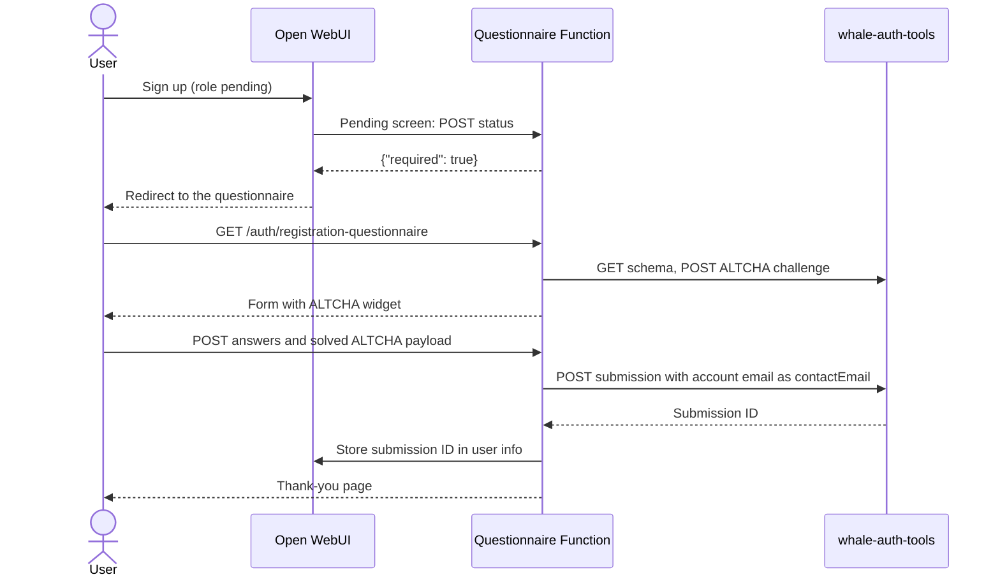

# Open WebUI Functionality

This part of the repository contains definitions of additional functionality created in the Open WebUI instance. Implementations may contain:

- Open WebUI Functions such as Filters, Actions, and Events, with configurable Valves
- Open WebUI Tools
- etc

## Components

### Functions

- SciLifeLab ALTCHA Browser Gate from [oi_altcha_browser_gate.py](functions/oi_altcha_browser_gate.py). An Event Function serving a standalone browser interstitial for the optional Helm proxy. See [ALTCHA browser gate](#altcha-browser-gate).

- Request Quota Guard from [oi_request_quota_guard.py](functions/oi_request_quota_guard.py). Restricts the number of user requests per minute and also logs user request usage.
- Rate Limit Enforcer from [oi_rate_limit_enforcer.py](functions/oi_rate_limit_enforcer.py). Restricts the number of user requests per minute.
- SciLifeLab Email Verification from [oi_email_verification_callback.py](functions/oi_email_verification_callback.py). An Event Function that sends signup verification emails through the Gmail API and records email ownership in the `email-verified` group. See [Email verification](#email-verification) for setup.
- SciLifeLab Account Approval Notification from [oi_account_approval_notification.py](functions/oi_account_approval_notification.py). An Event Function that adds users to `account-verified` and emails them through the Gmail API when an administrator changes their role from `pending` to `user`, and by default undoes approvals of users who have not submitted the registration questionnaire. See [Account approval notification](#account-approval-notification) for setup.

- SciLifeLab Registration Questionnaire from [oi_registration_questionnaire.py](functions/oi_registration_questionnaire.py). An Event Function serving a questionnaire about affiliation and planned use to pending users and storing the answers in `whale-auth-tools`. See [Registration questionnaire](#registration-questionnaire).

Activate either the Request Quota Guard or the Rate Limit Enforcer filter, not both.

### Actions

- Rate Limit Feedback from [oi_rate_limit_ui_button.py](functions/oi_rate_limit_ui_button.py). Adds a UI button that displays the current configured user request limit.

### Valves

- [oi_valves.py](functions/oi_valves.py) contains configurable settings.
- Individual Functions also define their own admin Valves, including the five [email verification valves](#email-verification-valves) and the five [account approval valves](#account-approval-valves).

## Installation

Only admin users can install and manage the Functions in Open WebUI.

To install:

1. Open the Admin Panel in Open WebUI as an admin user.
2. Navigate to the Functions tab and click on New Function.
3. Paste in the definition of the function in the window.
4. The Title, Description, and function id will be filled in automatically for you.
5. Click on Save.
6. Click the back arrow to return to the overview of Functions and enable the Function. Set filters and actions to Global if they should apply across models. Event Functions, such as email verification and account approval notification, only need to be enabled; they respond to application events.

To modify a setting (valve) for a function, click on the configuration icon and edit the value.

## Email verification

Use an Open WebUI build that supports Event Functions and the `auth.signup` and `user.updated` events. The callback sends verification emails for newly created accounts with the `pending` role. Opening the email link displays a confirmation form; clicking **Verify email** submits a POST that adds the user to the `email-verified` group. Visiting the link alone does not verify the account.

Verification does not change the user's role or approve the account. Administrator approval remains separate. When a user's email address changes, the Function removes their verification group membership, and links issued for the previous address are rejected. It does not automatically send a replacement email on email changes; users can [request one](#resending-verification-emails).



The confirmation, success, and error pages use Open WebUI-style layouts with browser-preference light/dark colors and a link back to Open WebUI. They load no external resources.

The verification success page and the resend response for already-verified pending accounts explain that the account is waiting for administrator review, that a confirmation email will follow approval, and that review may take several working days. Approval and its confirmation email are handled separately from this Function.

When a link is expired, invalid, missing its token, or was issued for a previous email address, both the link and the **Verify email** submission return an HTTP 400 error page with a **Request a new verification email** button. The button opens the [resend page](#resending-verification-emails), which applies the usual session and eligibility checks. Other failures, such as a deleted account or a missing `email-verified` group, show an error page without the button.

### Setup

1. In Open WebUI, create a group named exactly `email-verified`, with no granted permissions and sharing disabled. The group name is fixed in the Function.
2. Set the default signup role to `pending`.
3. Configure a Google service account with delegation to the sending Workspace mailbox and the Gmail scope `https://www.googleapis.com/auth/gmail.send`. The From address must be authorized for that mailbox.
4. Configure the environment variables below for every Open WebUI replica. Supply credentials and signing secrets through Kubernetes Secrets.
5. Install and enable `oi_email_verification_callback.py` using the installation steps above, then configure its Valves. Open WebUI installs the packages from the Function's `requirements` header (`google-auth`, `requests`, `itsdangerous`) when loading it; if runtime package installation is unavailable, include them in the image.
6. Optionally add the [resend button](#resending-verification-emails) to the pending-user screen.
7. Restart all Open WebUI replicas after initial installation or changes to deployment settings so each process registers the configured GET/POST callback and resend routes before the frontend catch-all route.

### Deployment settings

| Environment variable | Value / purpose |
| --- | --- |
| `EMAIL_VERIFICATION_URL` | Full public HTTPS callback URL, e.g. `https://your-host/auth/verify-email`. Must have a non-root path and no query string or fragment. |
| `GMAIL_CREDENTIALS_JSON` | Google service-account credentials as JSON, supplied from a Kubernetes Secret. |
| `GMAIL_DELEGATED_USER` | Existing Google Workspace mailbox the service account impersonates. |
| `GMAIL_SENDER_EMAIL` | Authorized From / Send As address for that mailbox. |
| `WEBUI_SECRET_KEY` | Shared Open WebUI signing secret, identical across replicas. |
| `EMAIL_VERIFICATION_SECRET` | Optional dedicated verification signing secret, identical across replicas. If omitted, the Function uses `WEBUI_SECRET_KEY`. |

The Function stays inactive until `EMAIL_VERIFICATION_URL` and all `GMAIL_*` variables are set: it registers no routes, sends no email, and logs a warning naming the missing variables. This keeps environments without Gmail settings, such as one restored from another deployment's database, from sending email. These settings are not Valves. Keep the callback URL stable while links are outstanding, and use the same signing configuration on every replica.

### Email verification valves

Saved admin Valve values override the optional environment defaults below. When neither is set, the built-in default applies. Environment defaults are read when the Function is loaded; changing them does not replace a saved Valve value.

| Valve | Built-in default | Environment default | Purpose |
| --- | --- | --- | --- |
| `token_ttl` | `24h` | `EMAIL_VERIFICATION_TOKEN_TTL` | Link lifetime: a positive integer number of seconds, or a duration with `s`, `m`, `h`, or `d`, e.g. `3600`, `30m`, `24h`, `7d`. |
| `sender_name` | `SciLifeLab OpenLLM` | `EMAIL_VERIFICATION_SENDER_NAME` | Display name in the From header; does not change the sending mailbox. |
| `email_subject` | `SciLifeLab OpenLLM: Verify your email address` | `EMAIL_VERIFICATION_SUBJECT` | Verification email subject. |
| `send_on_signup` | `true` | `EMAIL_VERIFICATION_SEND_ON_SIGNUP` | Whether to send verification emails for new pending signups and resend requests. |
| `resend_cooldown` | `5m` | `EMAIL_VERIFICATION_RESEND_COOLDOWN` | Minimum time between emails to the same user, in the same duration format as `token_ttl`. Counted from the signup email or the last resend. |

Sender name and subject must be nonempty and contain no control characters. Invalid `token_ttl` and `resend_cooldown` durations are rejected. `send_on_signup` accepts boolean values such as `true`/`false`. Environment defaults are validated the same way; an invalid value prevents the Function from loading.

Changing `token_ttl` also changes the validity window for already-issued links. All callback and resend routes refresh saved Valves before validating tokens, so subsequent verification requests use the current TTL across replicas.

To pause new signup and resent emails, set `send_on_signup=false` while keeping the Function enabled. Existing links and email-change revocation continue working. Re-enabling sending does not send emails retroactively to signups that occurred during the pause.

Disabling the Function in the admin interface stops event handling, including email-change revocation; it does not remove routes already registered in a running process until it restarts. Use `send_on_signup` for an email-only pause.

### Resending verification emails

Pending users who have not verified their email can request a new link from the Open WebUI account pending screen. The Function registers `EMAIL_VERIFICATION_URL` + `/resend` (e.g. `/auth/verify-email/resend`): GET shows a confirmation button and POST sends the email.

To show the button, set Admin Settings > General > **Pending User Overlay Content** (or the `PENDING_USER_OVERLAY_CONTENT` environment variable) to text that includes a form posting to the resend path. Keep the form on a single line, because the overlay converts line breaks to `<br>`:

```html
Please verify your email address using the link we sent you. Your account will then be reviewed by an administrator.
<form method="post" action="/auth/verify-email/resend"><button type="submit" style="margin-top:1rem;padding:.5rem 1.25rem;border-radius:9999px;background:rgba(128,128,128,.15);cursor:pointer">Resend verification email</button></form>
```

A markdown link such as `[Resend verification email](/auth/verify-email/resend)` also works and opens the GET confirmation page.

A resend request sends a new link only when all of these are true:

- The request carries a valid Open WebUI session (the `token` cookie issued at signup). Signed-out visitors get a sign-in prompt. When MFA is enabled, Open WebUI issues no session to pending users, so the button cannot identify them.
- The user's role is `pending`, they are not in `email-verified`, and the group exists.
- `send_on_signup` is `true`.
- No email was sent to that user within `resend_cooldown`. The cooldown is held in memory per backend process, so with several replicas or workers a user can receive up to one email per process per cooldown, and a restart clears it.

Cross-site POSTs are rejected using the `Origin` and `Sec-Fetch-Site` headers, in addition to the default `SameSite=Lax` auth cookie. Earlier links remain valid until `token_ttl` expires. Gmail failures show an error page and do not start the cooldown.

## Account approval notification

[oi_account_approval_notification.py](functions/oi_account_approval_notification.py) adds the user to the existing `account-verified` group and sends an email when their role changes from `pending` to `user`, for example when an administrator approves the account in Admin Panel > Users or a SCIM provider activates it. It is independent of email verification and does not check the `email-verified` group.

Open WebUI's `user.role_updated` event (and SCIM's `user.updated` event) contains only the new role. To recognize approvals, the Function stores the key `scilifelab_awaiting_approval` in the user's `info` field while the user is `pending`:

- when the account is created (`user.created` / `auth.signup`) with the `pending` role;
- when a user's role changes to `pending`;
- for all existing `pending` users, the first time each backend process handles any event after loading the Function.

When a marked user's role becomes `user`, the Function adds them to `account-verified`, preserves their other group memberships, removes the marker, and sends the email. Group assignment also happens when emails are paused or the user has no email address. Existing membership is left unchanged. If the group is missing or assignment fails, processing fails before sending email and the marker remains for a later role event to retry; there is no automatic retry. Role changes for unmarked users, such as demoting an admin to `user`, neither assign the group nor send email. A change from `pending` to `admin` or another role removes the marker without an email. The marker is removed before sending, so repeated events do not send twice; Gmail failures are logged and not retried.

### Questionnaire requirement

With the `require_questionnaire` Valve on (the default), users must submit the [registration questionnaire](#registration-questionnaire) before they can be approved. When a marked user's role becomes `user` and their `info` has no `scilifelab_questionnaire` entry, the Function sets the role back to `pending`, keeps the approval marker, and neither assigns `account-verified` nor sends an email. It logs a warning with the user ID. Approving the user again after they submit the questionnaire completes normally.

Open WebUI events cannot block a role change, so the approval is undone after the fact, normally within moments. The administrator's user list shows the user as `user` until it is refreshed. Approvals straight to `admin` and role changes for unmarked users, such as accounts approved before the Function was installed, are not checked. Turn the Valve off, or install the questionnaire Function first, before enabling this in an environment without the questionnaire; otherwise no pending user can be approved.

Limitations:

- An account approved before any event reaches the Function after installation may not have been marked yet, so neither group assignment nor email occurs for it. Installing the Function, then any action that publishes an event, such as a new signup or an administrator editing a user, marks existing pending users.
- Role changes Open WebUI makes without publishing an event, such as OAuth role management at sign-in, do not trigger group assignment or emails.

### Account approval setup

1. Create a group named exactly `account-verified` in Open WebUI, with no granted permissions and sharing disabled. The Function does not create the group or remove membership on later role changes.
2. Configure the Gmail deployment settings `GMAIL_CREDENTIALS_JSON`, `GMAIL_DELEGATED_USER`, and `GMAIL_SENDER_EMAIL` as described under [email verification deployment settings](#deployment-settings). The Helm chart sets them when `emailVerification.enabled=true`. The Function stays inactive, logging one warning, until all three are set.
3. Install and enable `oi_account_approval_notification.py` using the [installation steps](#installation). Open WebUI installs the `google-auth` and `requests` packages from its `requirements` header.
4. Optionally set the `login_url` Valve, or set Open WebUI's `WEBUI_URL`, so the email contains a sign-in link.

No restart is needed; the Function registers no routes.

### Account approval valves

Saved admin Valve values override the optional environment defaults below. Environment defaults are read and validated when the Function is loaded.

| Valve | Built-in default | Environment default | Purpose |
| --- | --- | --- | --- |
| `send_on_approval` | `true` | `ACCOUNT_APPROVAL_SEND` | Whether to send approval emails. When `false`, approvals still assign the group and clear the marker without an email; emails are not sent retroactively. |
| `sender_name` | `SciLifeLab OpenLLM` | `ACCOUNT_APPROVAL_SENDER_NAME` | Display name in the From header and the email text. |
| `email_subject` | `SciLifeLab OpenLLM: Your account has been approved` | `ACCOUNT_APPROVAL_SUBJECT` | Approval email subject. |
| `login_url` | empty | `ACCOUNT_APPROVAL_LOGIN_URL` | HTTPS sign-in link included in the email. When empty, Open WebUI's `WEBUI_URL` is used if it is an HTTPS URL; otherwise the email has no link. |
| `require_questionnaire` | `true` | `ACCOUNT_APPROVAL_REQUIRE_QUESTIONNAIRE` | Return users approved to `user` without a registration questionnaire submission to `pending`, without group membership or email. See [Questionnaire requirement](#questionnaire-requirement). |

Sender name and subject must be nonempty and contain no control characters; `login_url` must be empty or an HTTPS URL.

## ALTCHA browser gate

The `altcha_browser_gate` Event Function serves a separate “Checking your browser”
page and delegates proof-of-work generation and verification to `whale-auth-tools`.
The optional `altchaGate` NGINX sidecar in the `openllm-charts` repository gates
browser navigation before it reaches Open WebUI. **No Open WebUI source changes,
frontend dependencies, or custom image rebuild are needed.** The Function alone
neither intercepts navigation nor blocks signup; the proxy provides enforcement.

An unverified GET receives the interstitial at its original URL. The page runs
ALTCHA automatically, submits the solution, and reloads the same URL after the
server sets a Secure, HttpOnly, SameSite=Lax, host-only clearance cookie. This
preserves the path, query and fragment without accepting arbitrary redirect URLs.
Direct visits to `/auth/verify-human` continue to `/` after verification. JavaScript
and HTTPS are required. A retry button appears on failures.

### Browser gate setup

1. Bootstrap the initial administrator with the chart's `altchaGate.enabled=false`
   (the default). Install `oi_altcha_browser_gate.py` in Admin Panel > Functions >
   New: paste, save as `altcha_browser_gate`, and enable. No Global setting is needed.
2. Configure the environment settings below on **every worker and replica** using
   the chart's `altchaGate` values and existing Kubernetes Secrets. Shared Redis
   6.2+ is required for atomic challenge consumption. HMAC secrets stay exclusively
   in whale-auth-tools.
3. Enable `altchaGate.enabled` in your environment overlay and restart all replicas
   through the normal deployment workflow. Enabling a Function does not replay
   startup; each worker must register its routes before receiving gated traffic.
4. Check the chart's exception paths against your callback URLs and API clients.
   Test a fresh browser, verification expiry, direct signup without a cookie,
   service/Redis outages, OAuth, email links, streaming, and WebSockets before rollout.

| Environment setting | Purpose |
| --- | --- |
| `WHALE_AUTH_URL` | Service base URL, normally `http://whale-auth-tools:8080`. HTTP is for a trusted internal network; otherwise use HTTPS. |
| `WHALE_AUTH_API_TOKEN` | Service Bearer credential, supplied from a Secret. Never exposed to browsers. |
| `ALTCHA_REDIS_URL` | Same Redis 6.2+ database on all replicas. Supply credentials through a Secret. |
| `ALTCHA_PUBLIC_ORIGINS` | Comma-separated exact HTTPS origins, e.g. `https://openllm.example.org,https://openllm-dev.example.org`. Include each public hostname; omit paths and trailing slashes. |

The Function installs `httpx==0.28.1` and `redis==8.0.1` through its metadata.
Include them in the image if runtime package installation is disabled. Missing
settings leave the Function inactive with a warning. With the proxy enabled,
missing/disabled Functions or service/Redis failures block protected traffic.
Restart after environment changes. To remove the gate, disable `altchaGate.enabled`
and redeploy; disabling only the Function intentionally blocks protected traffic.

| Valve | Default | Purpose |
| --- | --- | --- |
| `clearance_ttl` | `3600` | Integer seconds the verified browser may access protected routes, from 60 to 86400. Saved settings refresh on requests; existing cookies retain their original expiry. |

Routes registered before the SPA catch-all:

- `GET /auth/verify-human`: standalone interstitial, with no-store and CSP headers.
- `POST /api/v1/altcha-gate/challenge`: service challenge, bound for at most ten minutes to a separate SameSite=Strict pending cookie. Each tab's challenge is stored separately. Returns `{"verified": true}` without a new challenge when the browser already has valid clearance.
- `POST /api/v1/altcha-gate/verify`: accepts JSON `{"altchaPayload":"<base64>"}` up to 16 KiB. Atomically consumes the issued challenge, compares it with the submitted challenge, then calls the service. The service also validates signed expiry. Success sets the clearance cookie to a random token.
- `POST /api/v1/altcha-gate/check`: returns 204 for valid clearance, 401 if absent/expired, or 503 if unavailable. The chart blocks direct public access and invokes it through an internal proxy subrequest. POST is deliberate: a missing Function must not be mistaken for Open WebUI's HTTP-200 SPA fallback for unknown GET paths.

The chart serves the pinned `altcha@3.5.0` widget locally at
`/auth/verify-human/altcha-3.5.0.min.js`, including its license. Widget v3 supports
the service's v2 challenge protocol. No external CDN or CORS configuration is needed.

Challenges are single-use, including failed verification attempts. **Clearance is
reusable until expiry**, as in a browser interstitial; it is not a one-account-per-
challenge quota. Redis loss invalidates outstanding checks and clearance. The
clearance cookie is SameSite=Lax so links from email, Slack, other sites and OAuth
returns keep it; cross-site POSTs to protected endpoints still omit it. Tabs verify
independently, and a new challenge never replaces existing clearance. The chart
rate-limits challenge and verify requests per client; the page reports 429s.

The chart exempts health checks, email callbacks, OAuth, static assets, WebSockets,
and API routes, which retain Open WebUI's normal authentication. Password signup,
signin and LDAP auth remain protected even under the broad API exception, including
trailing-slash forms. Unverified API submissions get 403 JSON asking the user to
reload; the proxy never replays their POST body. OAuth and other provisioning remain
outside this proof-of-work gate. Documentation routes served by the separate docs
Service also remain public. This is an anti-abuse check, not a substitute for API
authentication, request-rate limits, or volumetric DDoS protection.

Function tests cover clearance, cookie separation, parallel tabs, cross-replica
state, replay, expiry, malformed and oversized payloads, service failure, origin checks, Valve validation, route reload,
and the missing-Function SPA fallback. Chart proxy tests cover routing and exceptions
with the real pinned NGINX image and an isolated fake backend.

## Registration questionnaire

The `registration_questionnaire` Event Function asks newly registered users for
the information administrators use to decide on approval. It serves a form at
`/auth/registration-questionnaire` with these questions:

- Which university or organisation are you affiliated to? (free text)
- Which position(s) do you hold? (PhD student, Postdoc, PI, Research engineer,
  Systems developer, Data steward, Bioinformatician, Other)
- How are you affiliated to SciLifeLab? (Infrastructure unit staff, Affiliated
  research group member, Other)
- What do you plan to use the OpenLLM service for? (check all that apply)
- Would you like to be added to the SciLifeLab Slack channel for users of the
  service? (Yes/No)

Question texts and choices come from the `whale-auth-tools` schema endpoint, so
they change with that service rather than with this Function. Selecting Other
requires the matching free-text answer. The form is rendered on the server and
submitted as a normal HTML form; apart from the ALTCHA widget, it needs no
JavaScript.



With the SciLifeLab Open WebUI fork, users go to the form automatically. The
fork's "Account Activation Pending" screen calls
`POST /api/v1/registration-questionnaire/status`, which returns
`{"required": true}` for a signed-in pending user with an email address and no
submission. The screen then does a full page load of the form. This happens
right after signup and whenever such a user returns. Otherwise the response is
`{"required": false}`, 401 when signed out, or 503 with `{"required": false}`
while the Function is disabled or unconfigured; the pending screen stays. The
endpoint is POST so that a missing Function is not mistaken for the frontend's
HTTP-200 fallback for unknown GET paths. Upstream Open WebUI images have no
redirect; use the overlay link below.

Only signed-in users with the `pending` role can open or submit the form; it
uses the session cookie Open WebUI issues at signup. Each account submits once:
after success the Function stores `{"id", "submittedAt"}` under
`scilifelab_questionnaire` in the user's `info`, and later visits show a
confirmation instead of the form. The answers themselves are stored only in
`whale-auth-tools`. The account email is always sent as `contactEmail`, so
administrators can match a submission (from `GET
/api/v1/questionnaire/submissions`) to the account, and it doubles as the Slack
invitation address. The Function neither approves accounts nor sends Slack
invitations; approval stays with administrators. The
[account approval Function](#questionnaire-requirement) returns users approved
before submitting to `pending` by default.

Invalid or incomplete answers re-render the form with the entered values and an
error list. An expired ALTCHA challenge (after ten minutes by default) or a
rejection by the service also re-renders the form, with a fresh challenge.
Service outages show a 503 page; nothing is stored in Open WebUI. Cross-site
POSTs are rejected using the `Origin` and `Sec-Fetch-Site` headers.

### Questionnaire setup

1. Deploy `whale-auth-tools` and give every Open WebUI replica the deployment
   settings below. In `openllm-charts`, `registrationQuestionnaire.enabled=true`
   sets both and serves the ALTCHA widget at the default `altcha_widget_url`.
2. Install `oi_registration_questionnaire.py` using the
   [installation steps](#installation) with the ID `registration_questionnaire`,
   and enable it. Open WebUI installs `httpx==0.28.1` from its `requirements`
   header. No Global setting is needed.
3. Restart all Open WebUI replicas so each process registers the routes before
   the frontend catch-all route.
4. Optionally, link pending users to the form from Admin Settings > General >
   **Pending User Overlay Content** (or `PENDING_USER_OVERLAY_CONTENT`). The
   fork redirects automatically, so the link is a fallback for upstream images
   or a failed status check. Keep the HTML on one line, because the overlay
   converts line breaks to `<br>`:

   ```html
   Your account can only be approved after you fill in a short questionnaire. <a href="/auth/registration-questionnaire">Fill in the questionnaire</a>
   ```

   The overlay can also hold the
   [resend verification email](#resending-verification-emails) form.

| Environment setting | Purpose |
| --- | --- |
| `WHALE_AUTH_URL` | Service base URL, normally `http://whale-auth-tools:8080`. Shared with the ALTCHA browser gate. |
| `WHALE_AUTH_API_TOKEN` | Service Bearer credential, supplied from a Secret. Used only server-side and never sent to browsers. |

The Function stays inactive, logging one warning, until both are set. Disabling
the Function makes already-registered routes return 503 until the next restart.

### Questionnaire valves

| Valve | Default | Purpose |
| --- | --- | --- |
| `require_altcha` | `true` | Embed the ALTCHA widget and send its payload. Keep it on while `whale-auth-tools` runs with `ALTCHA_REQUIRED=true` (the `openllm-charts` default), or every submission is rejected. |
| `altcha_widget_url` | `/static/altcha/altcha-3.5.0.min.js` | Same-origin path of the ALTCHA v3 widget module. `openllm-charts` mounts the pinned widget there when `registrationQuestionnaire.enabled=true`, with or without the ALTCHA browser gate. Elsewhere, serve the widget on the same origin and set this path. |

Saved Valves are reloaded on every request.

## Tests

Run the unit tests with the optional test dependencies from [pyproject.toml](pyproject.toml):

```bash
cd openwebui-functionality
uv run --extra test pytest
```

Email verification tests cover environment defaults and saved overrides, duration and email header validation, signup sending and pausing, inactivity when deployment settings are missing, email-change revocation, TTL refresh on existing routes, error pages for expired, invalid, and outdated links, resend eligibility, cooldown, and cross-site rejection, and email branding. Account approval notification tests cover Valve defaults and validation, pending-user marking and backfill, approval emails and group assignment from role and SCIM events, undoing approvals without a questionnaire submission and re-approval after submission, existing memberships, group failures retaining the marker, no email for unmarked users, admin approvals, or paused sending, idempotency, inactivity when deployment settings are missing, sign-in link selection, and email content. Registration questionnaire tests cover the redirect status for each kind of user, form rendering from the service schema, ALTCHA embedding and the `require_altcha` switch, submission payloads and the user-info marker, validation and service rejections that keep entered answers, service failures, refusals for signed-out, non-pending, and already-submitted users, cross-site and oversized POSTs, inactivity, route registration, and Valve validation. Gmail, `whale-auth-tools`, and Open WebUI database calls are mocked; no real emails or requests are sent.
